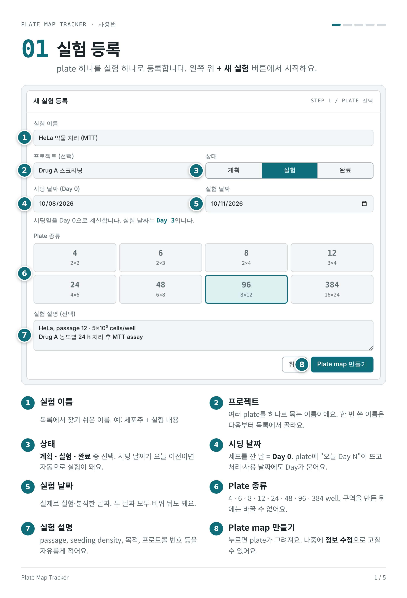
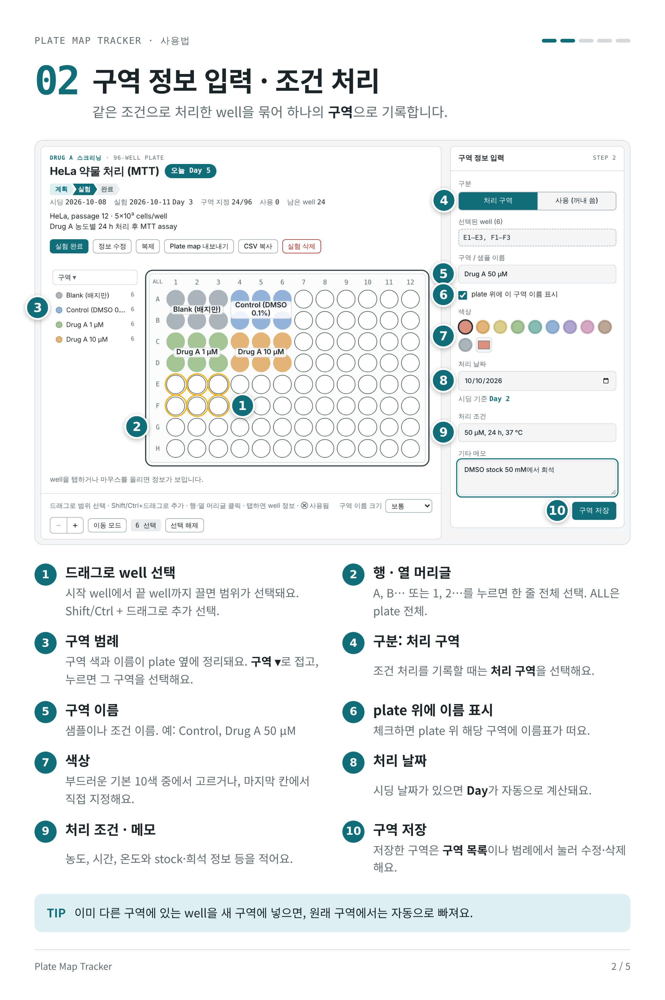
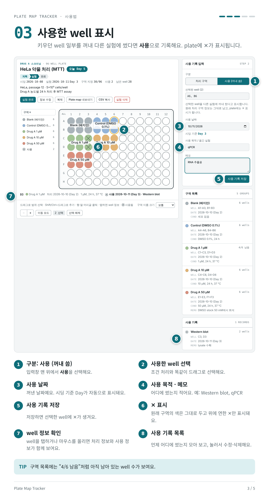
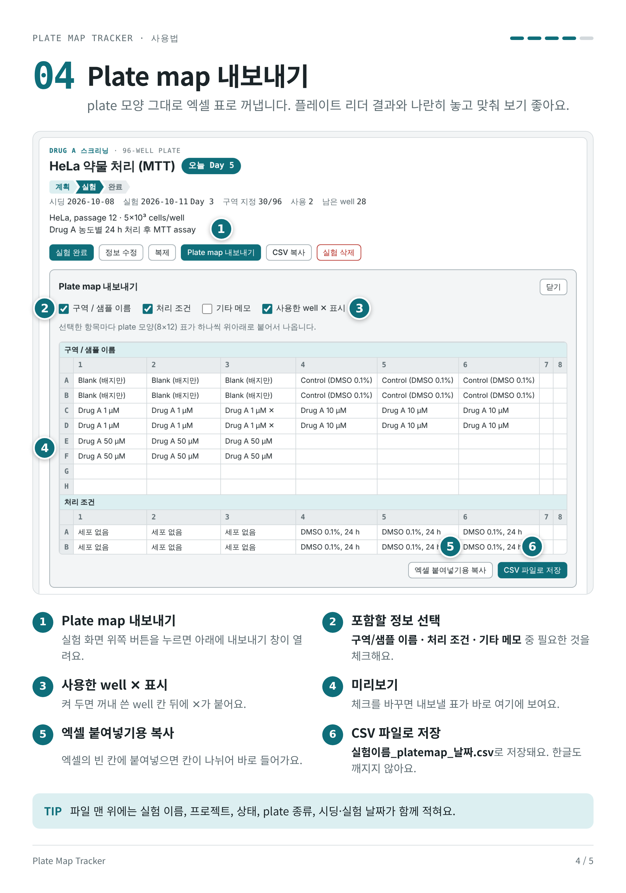
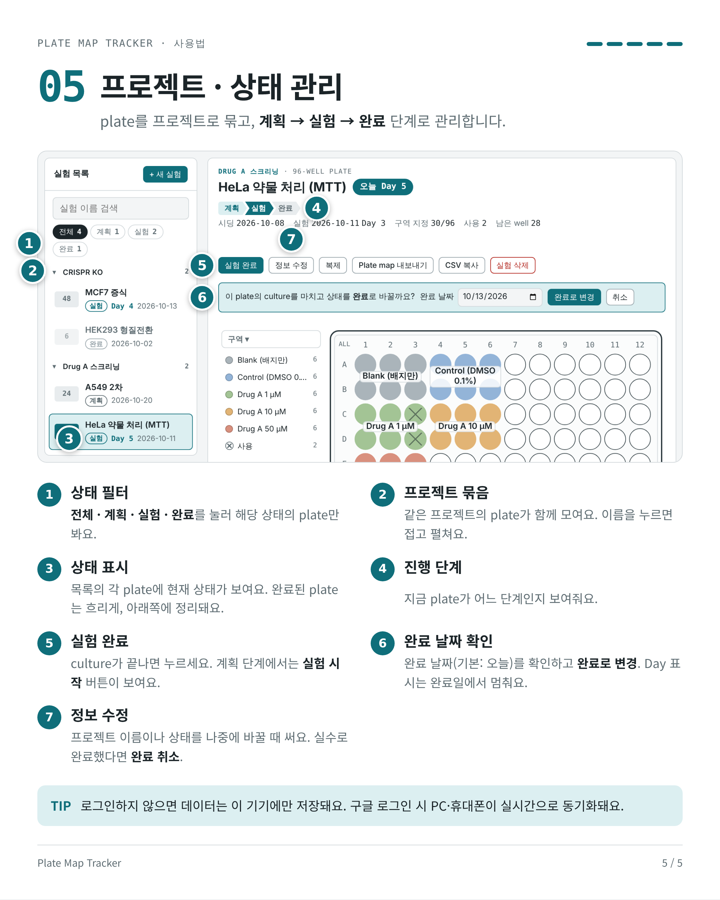
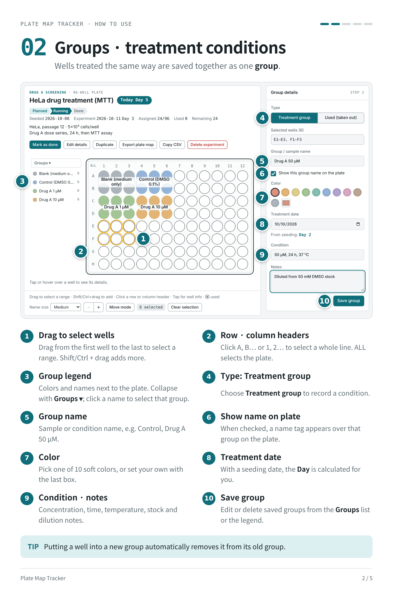
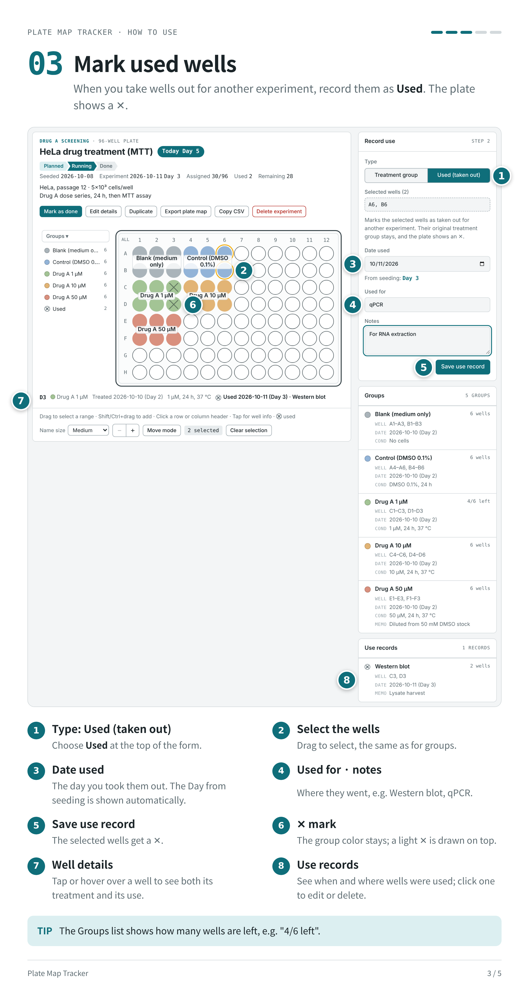
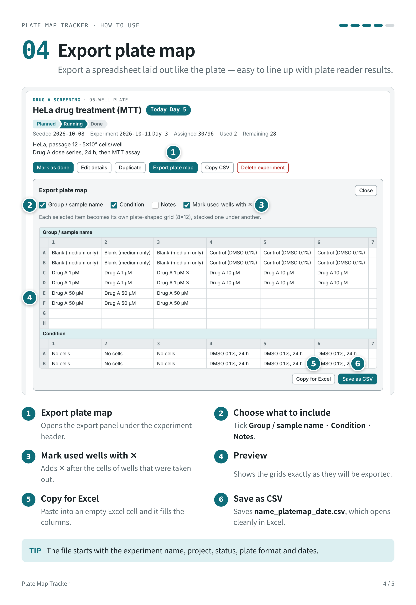
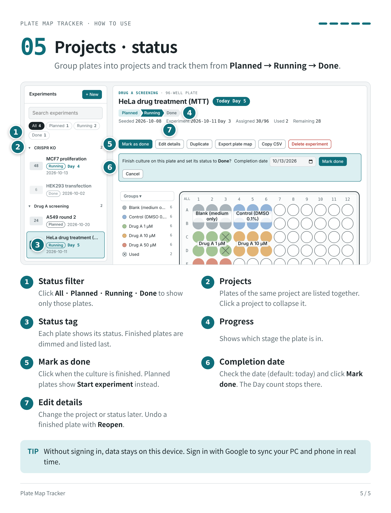

# Plate Map Tracker

**한국어** | [English](#english)

Well plate(4–384 well)의 샘플 위치, 처리 조건, 사용 기록을 관리하는 웹앱입니다.

- 한국어: https://heasilmoon.github.io/plate-map/ko/
- English: https://heasilmoon.github.io/plate-map/en/

### 주요 기능
- 실험(plate) 등록: 프로젝트, 상태, 시딩 날짜(Day 0), 실험 날짜, plate 종류
- 드래그로 well 구역 지정, 색상·처리 조건·메모 기록
- plate 위 구역 이름 표시 (이름 크기 4단계 조절), plate 옆 구역 범례
- 꺼내 쓴 well은 "사용"으로 ✕ 표시
- 상태 관리: 계획 → 실험 → 완료
- 기존 plate 복제 (구역 배치 그대로)
- Plate map 내보내기 (CSV)
- 백업 내보내기/불러오기 (JSON)
- 화면 모드 선택: 자동 / 라이트 / 다크
- 앱 안의 사용법(? 사용법 버튼)과 첫 방문용 예시 plate
- 휴대폰 홈 화면에 설치하는 웹앱(PWA), 오프라인 사용 가능

### 데이터
- 데이터는 사용하는 기기의 브라우저에만 저장되며, 서버로 전송되지 않습니다.
- 브라우저 데이터를 지우면 함께 삭제되므로 **백업 내보내기(JSON)를 주기적으로** 해 두세요.

### 사용법

---

## English

[한국어](#plate-map-tracker) | **English**

A web app for tracking sample positions, treatments and used wells on 4–384 well plates.

- Korean: https://heasilmoon.github.io/plate-map/ko/
- English: https://heasilmoon.github.io/plate-map/en/

### Features
- Register experiments (plates): project, status, seeding date (Day 0), experiment date, plate format
- Drag to select wells into groups; record color, condition and notes
- Show group names on the plate (4 text sizes) and a group legend next to it
- Mark wells taken out for other experiments as "Used" (shown with ✕)
- Track status: Planned → Running → Done
- Duplicate an existing plate with its group layout
- Export the plate map as CSV
- Backup export/import (JSON)
- Theme choice: Auto / Light / Dark
- Built-in guide (? Help button) and sample plates on first visit
- Installable web app (PWA) for your phone's home screen; works offline

### Data
- Data is stored only in your browser on the device you use; nothing is sent to a server.
- Clearing browser data deletes it, so **export a JSON backup regularly**.

### How to use

